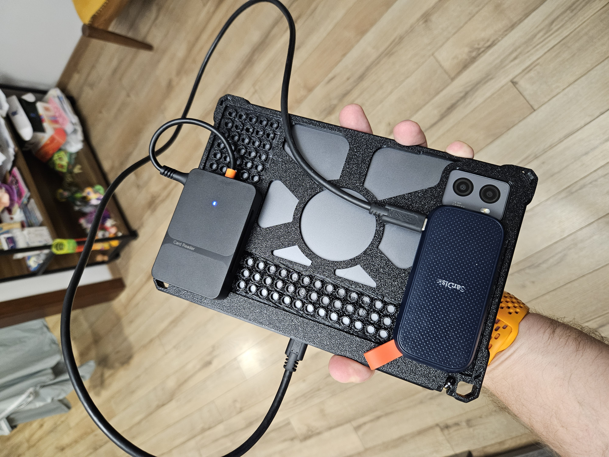
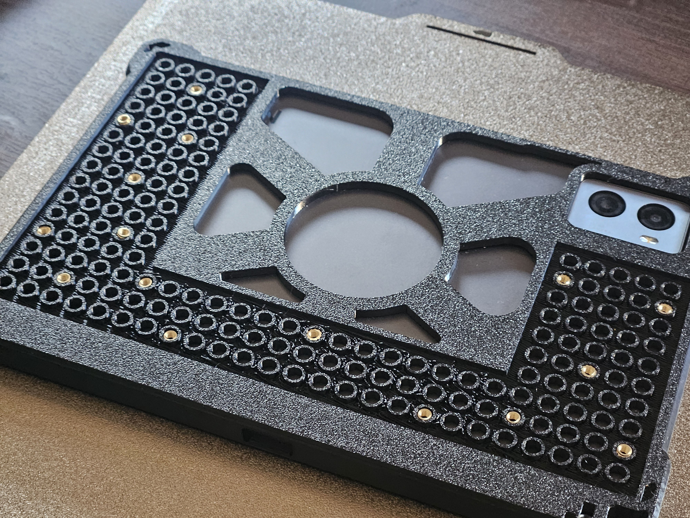
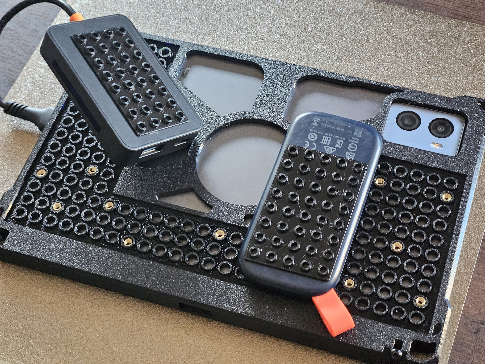
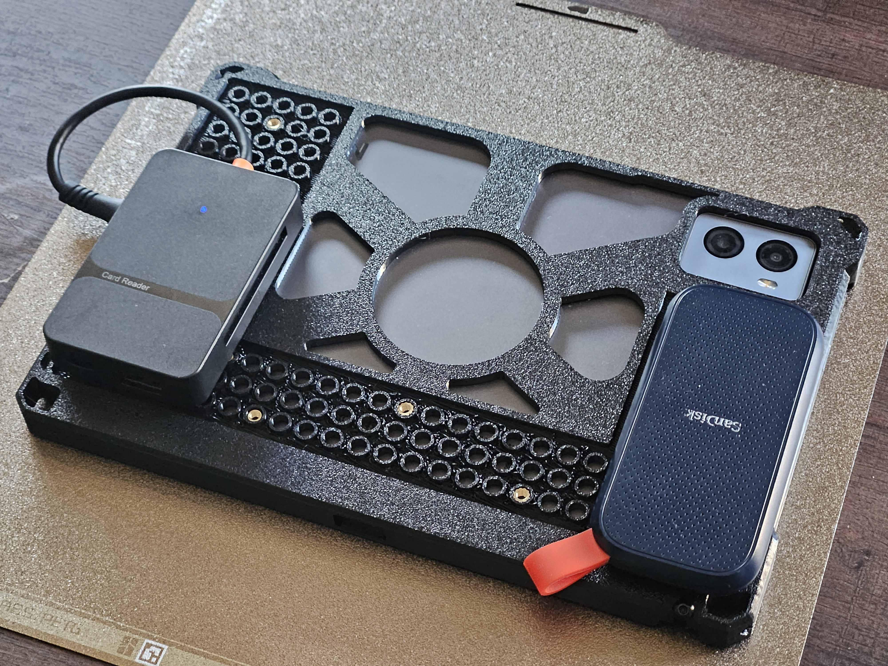
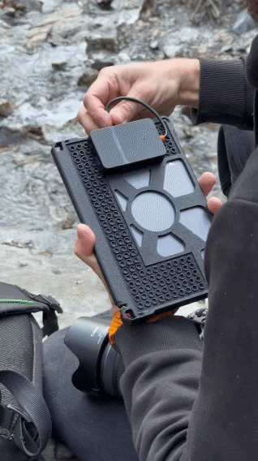

# OSSMI — Open Source Small Mount Interface

**Small devices. One open interface.**

OSSMI is an open hardware project exploring a reusable **8 mm LEGO-compatible mechanical mounting interface**. It started with a 3D-printed Lenovo Y700 tablet frame for attaching a card reader and SSD — but the same idea can help connect, mount, organize and rearrange other small devices and objects.

**One attachment interface, many things to make.**

## Real prototype

Real prototype photos and an animated demonstration, not renders. All six media items have equal-width cells in the gallery.

| | | |
|:---:|:---:|:---:|
|  |  |  |
|  |  |  |

[**Watch the prototype demonstration (MP4)**](media/video/ossmi-vid-0.mp4)

## How it works

- **OSSMI-Q (Quick)** uses a stud-and-socket grid for tool-free attachment where the materials and fit provide suitable friction retention.
- **OSSMI-S (Secure)** adds optional **M3 × 0.5** fasteners. In experimental rigid-material designs, such as aluminum or wood, the geometry can provide alignment while screws provide retention; this **does not automatically make the panel OSSMI-Q-compatible**.

By convention, the **host carries receiving sockets** and the **removable adapter carries studs**. The grid pitch is **8 mm**. The interface describes how pieces meet, not the shape of the bracket, case or product built around them.

## Get started — print your first useful OSSMI base

You don't need Python or CAD software to try OSSMI. Start with the ready-to-print **universal base**, suitable for experimenting with attaching accessories to a laptop, desk or another suitable surface.

**0. Calibrate your FDM printer.** Follow your printer manufacturer's instructions to check dimensional accuracy and print quality before printing mating parts.

**1. Download all four STL variants** from [`cad/examples/universal-base/`](cad/examples/universal-base/). They are complete 10×6 mounting bases, not disposable calibration blocks. The current set differs by receiver tube outside diameter: **6.51, 6.65, 6.71 and 6.75 mm**. The nominal grid pitch remains **8 mm**.

**2. Print the four bases** using the same filament and print settings. Keep each variant identified by its filename or diameter. These four are the variants currently published; more sizes may be added later.

**3. Find your fit.** Use a normal, undamaged, genuine LEGO System brick or plate with standard studs. Test how each base engages, holds during gentle handling and releases by hand. Choose the version that fits securely **without excessive force or visible damage**. If none fits, don't force it: consult the [FDM fit guide](docs/calibration/fdm/CALIBRATION_FDM_OSSMI_Q.md) and adjust your printing process or model.

**4. Put the working base to use.** The receiving base can be attached to a suitable clean surface with an appropriate **removable, surface-compatible adhesive**. For example, I attached one to the back of my MacBook so I can mount an SSD or a 4G modem using a **matching studded OSSMI accessory adapter**. The universal base alone does not attach an unmodified SSD: the accessory also needs a studded mating piece. [Generate a studded adapter](generator/ossmi_adapter.py) if you don't already have one. Check adhesive suitability, laptop finish, heat and ventilation, and retention before carrying or moving equipment.

**That's it:** your first prints are already useful mounting bases, and choosing the best-fitting one also helps identify a working print fit for your printer and material. This is a practical fit check, **not a guarantee** of compatibility on every printer or a safety/load rating. For M3 heat-set inserts, follow the separate [OSSMI-S guide](docs/calibration/fdm/CALIBRATION_FDM_OSSMI_S.md).

## Advanced — generate custom pads with Python and OpenSCAD

You'll need Python 3 and [OpenSCAD](https://openscad.org/) to render or export the generated models. The Python scripts themselves use only the standard library.

```bash
# Clone this repository
git clone https://github.com/kivadratik-1/ossmi.git
cd ossmi

# Generate an 8 × 5 receiving (host) pad
python3 generator/ossmi_host.py 8 5

# Generate an 8 × 5 studded (accessory) pad
python3 generator/ossmi_adapter.py 8 5

# Optional: export them to printable STL files
openscad -o ossmi_host_8x5.stl ossmi_host_8x5.scad
openscad -o ossmi_adapter_8x5.stl ossmi_adapter_8x5.scad
```

**Current Python generator dimensions:** rectangular width/length = `N × 8 − 0.2 mm` per axis. Host plate thickness = **3.0 mm**. Studded adapter base = **0.8 mm**, studs = **Ø4.8 × 1.8 mm**. These are **experimental reference-generator dimensions**, not production tolerances; test fit and retention before use. See [the generators](generator/).

## What could you build?

A tablet with a removable card reader, a phone and power-bank mount, an SSD holder on a laptop, a streaming box behind a TV, a power bank mounted alongside a portable solar panel, a sensor bracket for a robot or experimental drone, or a reconfigurable panel inside a portable equipment case. Even a removable fixture for a desk or travel workspace could use the same interface.

These examples are **ideas, not finished OSSMI products or validated applications**. For transport, machinery, airborne and public-travel settings, the surrounding product needs its own appropriate engineering, permissions and testing.

## Project status

**OSSMI v0.1.5 — public draft.** A physical Lenovo Y700 prototype and two Python → OpenSCAD generators exist. Canonical fit tolerances, M3 anchor-coordinate profiles, independent cross-printer tests and performance ratings are **not yet established**. The design is **not a safety-rated or certified mounting system**.

## Join the project

Print a test pad, design a new bracket, share the editable source and print settings, measure what fits, or report what fails. Open an [Issue](https://github.com/kivadratik-1/ossmi/issues) or send a Pull Request. Independent compatible designs are the point of OSSMI.

**Build something useful. Share what you learn.**

## Documentation and licensing

- [OSSMI Standard & Manifesto — v0.1.5](OSSMI_STANDARD_v0.1.5.md)
- [OSSMI-Q FDM calibration — ordinary LEGO reference fit](docs/calibration/fdm/CALIBRATION_FDM_OSSMI_Q.md)
- [OSSMI-S calibration — M3 heat-set inserts and fixed 8 mm grid](docs/calibration/fdm/CALIBRATION_FDM_OSSMI_S.md)
- [CERN Open Hardware Licence — Weakly Reciprocal 2.0](LICENSE) — applies to OSSMI reference hardware sources explicitly released under it.
- [Ready-to-print universal bases (four fit variants)](cad/examples/universal-base/)
- [Python pad generators](generator/) — software licensing is being clarified separately; the hardware license alone should not be assumed to license all scripts.

OSSMI is not affiliated with, endorsed by or certified by the LEGO Group.

---

**The interface is open. What you build with it is up to you.**
